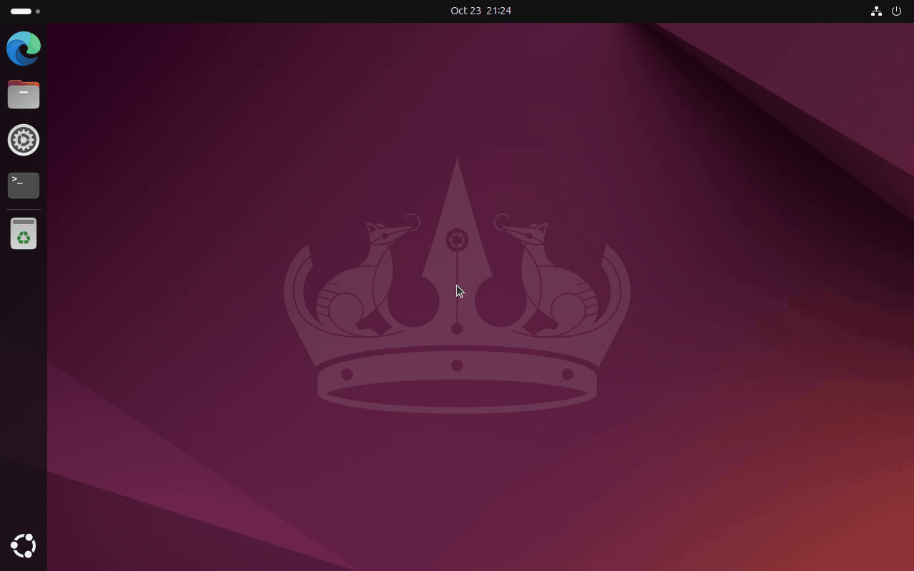

# NetworkManager GlobalProtect VPN Plugin

NetworkManager VPN plugin for GlobalProtect (Palo Alto Networks) with SAML/SSO authentication support.



<details>
<summary>The same on KDE Plasma</summary>


</details>

<details>
<summary>Screenshots</summary>


</details>

The recordings are made by the end-to-end tests ([tests/e2e](tests/e2e/README.md)):
the desktop, NetworkManager, the editors, the VPN service and Edge are real;
the company "Contoso", its sign-in pages and the VPN gateway are fictional.

## Features

- **NetworkManager integration** - manage VPN like any other connection
- **SAML/2FA authentication** via browser (Edge, Firefox, Chrome)
- **Standard login & RSA token portals** - interactive username/password/OTP
  prompts via desktop dialogs (see [docs/INTERACTIVE_AUTH.md](docs/INTERACTIVE_AUTH.md))
- **Desktop support** - GNOME Settings (GTK3/GTK4) and KDE Plasma
- **Routing control** - configure which traffic goes through VPN
- **Systemd service** - automatic VPN service management via D-Bus

## Installation

Add the apt repository and install - dependencies, upgrades and the GNOME/Plasma
choice are handled by apt:

```bash
curl -fsSL https://wmp.github.io/GlobalProtect-SAML-NetworkManager/gpclient-archive-keyring.gpg \
  | sudo tee /usr/share/keyrings/gpclient-archive-keyring.gpg > /dev/null

echo "deb [arch=$(dpkg --print-architecture) signed-by=/usr/share/keyrings/gpclient-archive-keyring.gpg] https://wmp.github.io/GlobalProtect-SAML-NetworkManager $(lsb_release -cs) main" \
  | sudo tee /etc/apt/sources.list.d/gpclient.list

sudo apt update
sudo apt install network-manager-gpclient-gnome    # GNOME, MATE, Cinnamon, XFCE
# or
sudo apt install network-manager-gpclient-plasma   # KDE Plasma
# or
sudo apt install network-manager-gpclient-plasma-6 # KDE neon (Ubuntu 24.04 with Plasma 6), amd64 only
```

`network-manager-gpclient-plasma` is built for the Plasma of the release (Qt5 on Ubuntu 22.04 and 24.04, Qt6 on 24.10 and 26.04). On Ubuntu 24.04 with Plasma 6 it does not fit. For **KDE neon** (Ubuntu 24.04 with Plasma 6 from `archive.neon.kde.org`) install `network-manager-gpclient-plasma-6` instead: it is built against the neon repository, for `amd64` only, and conflicts with `network-manager-gpclient-plasma` (only one Plasma generation can use the plugin). Ubuntu 24.04 with Plasma 6 from other sources (for example Kubuntu Backports) is not tested.

Supported: Ubuntu 22.04, 24.04, 24.10 and 26.04, `amd64` and `arm64`. Details, deb822 format and
removal instructions: [docs/APT_REPO.md](docs/APT_REPO.md).

**Ubuntu 22.04 only:** `python3-sdbus` is not in apt, install it with pip first:
```bash
pip3 install sdbus
```

<details>
<summary>Alternative: individual .deb files</summary>

Download the packages for your Ubuntu version from
[GitHub Releases](https://github.com/WMP/GlobalProtect-SAML-NetworkManager/releases)
(newer releases list their files in a table by Ubuntu version and architecture; older ones do not).
You need **network-manager-gpclient** plus either
**network-manager-gpclient-gnome**, **network-manager-gpclient-plasma** (or
**network-manager-gpclient-plasma-6** on KDE neon), and
the GUI package requires exactly the same version of the core package - so
install them in one go and let apt sort out the dependencies:

```bash
sudo apt install ./network-manager-gpclient_*.deb ./network-manager-gpclient-gnome_*.deb
```

`dpkg -i` on a single file fails on purpose here; use `apt install ./file.deb`
(or the repository above).
</details>

### Migrating from `globalprotect-openconnect`

If you previously had the `globalprotect-openconnect` package installed,
remove it first — our package declares a `Conflicts:` against it and
`dpkg -i` will otherwise refuse to install:

```bash
sudo apt remove globalprotect-openconnect
sudo apt autoremove
```

Installing from the apt repository pulls the runtime prerequisites
(`openconnect`, `python3-sdbus`, `vpnc-scripts`) in by itself. On Ubuntu 22.04
`python3-sdbus` is not in apt — use the `pip3 install sdbus` step shown above
instead.

Thanks to @ottuzzi for the writeup
([#3](https://github.com/WMP/GlobalProtect-SAML-NetworkManager/issues/3)).

## Usage

1. Open GNOME Settings → Network or KDE Network Settings
2. Add VPN → GlobalProtect
3. Enter the portal address (e.g. `vpn.example.com`)
4. Connect - a browser opens for SAML authentication

If your organisation gave you a *gateway* address rather than a portal
address, also tick **Address is a gateway (skip the portal)**.

When the portal offers several gateways, the first one it proposes is used
automatically; after the first successful connection the full list appears
in the **Preferred gateway** drop-down, so you can pin a different one.

Portals that use a standard login (username/password) or an RSA SecurID
token instead of SAML are supported too - the plugin asks for the
credentials in a dialog when gpclient needs them. See
[docs/INTERACTIVE_AUTH.md](docs/INTERACTIVE_AUTH.md) for details and for
storing the username/password in the connection.

```bash
# Or via command line
nmcli connection up "GlobalProtect VPN"
```

### Connection settings

Everything the editors show lives in the connection's `vpn.data`, so it can
also be set with `nmcli connection modify "My VPN" +vpn.data key=value`:

| Key | Default | Meaning |
|-----|---------|---------|
| `gateway` | (required) | Portal address, or gateway address with `as-gateway=true` |
| `as-gateway` | `false` | The address is a gateway - skip the portal workflow |
| `preferred-gateway` | (empty) | Gateway to use; empty means the portal's first proposal. Falls back to the first proposal when the value is not offered |
| `gateway-list` | (written by the service) | The portal's gateway list, `;`-separated. Read by the editors to fill the drop-down. The whole list after reading it page by page, or a list that fits one page (both need gpclient's `Found N` line); otherwise the stored entries plus the ones seen last time |
| `gateway-list-count` | (written by the service) | gpclient's `Found N gateways in portal config` count when the list was last read completely. It marks `gateway-list` as complete; the list is read again when the portal reports another number, and never without that line |
| `auth-mode` | `saml` | `saml` = browser login, `credentials` = username/password collected upfront |
| `username` | (empty) | Username for portals that ask on the terminal |
| `browser` | `edge` | `edge`, `firefox`, `chrome`, `chromium`, `default`, or a path to your own wrapper ([details](docs/EDGE_WRAPPER.md#alternative-browsers)) |
| `fix-openssl` | `auto` | Legacy TLS renegotiation for portals with an old TLS stack. `auto` retries once when the portal needs it and then stores `true` in the profile; `true` uses it from the start; `false` never does |
| `hip` | `true` | Send the HIP (Host Integrity Protection) report |
| `dns` | (empty) | Override the VPN DNS servers, `;`-separated. Empty uses the servers the gateway pushes |
| `dns-domains` | (empty) | Extra search domains, space-separated, added to the ones the gateway pushes |

The **Connect timeout** field is NetworkManager's own `vpn.timeout`, not a
`vpn.data` item: set it with `nmcli connection modify "My VPN" vpn.timeout 180`.
NetworkManager stops the connection after that many seconds, and the login in
the browser counts towards it. `0` means the NetworkManager default, usually
60 s, which is often too short for a SAML login with MFA. New connections with
browser login start with 180 s; existing connections keep their value
([#46](https://github.com/WMP/GlobalProtect-SAML-NetworkManager/issues/46)).

The DNS servers and search domains the gateway pushes are reported to
NetworkManager as part of the VPN's IP configuration, so they survive
NetworkManager's own DNS recalculations (they used to be applied only by
vpnc-script and were wiped on the next recalculation - see
[#15](https://github.com/WMP/GlobalProtect-SAML-NetworkManager/issues/15)).
This needs the vpnc hook `/etc/vpnc/connect.d/90-gpclient-routing` that the
package installs.

By default all traffic goes through the VPN. With **Use this connection only
for resources on its network** (IPv4 tab of the connection, `ipv4.never-default
yes`) only the networks the gateway announces go through the tunnel, and the
VPN DNS servers answer only for the VPN's domains:


The password for `auth-mode=credentials` is a secret, not data:
`nmcli connection modify "My VPN" +vpn.secrets password=...`

## Packages

| Package | Description |
|---------|-------------|
| `network-manager-gpclient` | Core VPN service (required) |
| `network-manager-gpclient-gnome` | GNOME/GTK integration |
| `network-manager-gpclient-plasma` | KDE Plasma integration, built for the Plasma of the release (Qt5 on Ubuntu 22.04 and 24.04, Qt6 on 24.10 and 26.04) |
| `network-manager-gpclient-plasma-6` | KDE Plasma 6 integration for KDE neon (Ubuntu 24.04 with Plasma 6), built against the neon repository; `amd64` only |

## Architecture

```
┌─────────────────────────┐
│   GNOME Settings        │
│   KDE Plasma NM         │
│   nm-connection-editor  │
└───────────┬─────────────┘
            │ Configuration
            ▼
┌─────────────────────────┐
│   NetworkManager        │
└───────────┬─────────────┘
            │ D-Bus
            ▼
┌─────────────────────────┐
│ nm-gpclient-service     │  ← Python VPN Service (systemd)
└───────────┬─────────────┘
            │
            ▼
┌─────────────────────────┐
│   gpclient / gpauth     │  ← VPN connection + SAML auth
└─────────────────────────┘
```

## Project Structure

```
├── service/                    # Python VPN service backend
│   └── nm-gpclient-service.py
├── plugins/
│   ├── gnome/                  # GNOME/GTK plugins (C)
│   └── plasma/                 # KDE Plasma plugin (C++/Qt)
├── config/                     # NetworkManager & systemd configuration
├── .github/
│   ├── scripts/                # build-apt-repo.sh (apt repository builder)
│   └── workflows/              # build/release and Pages publishing
├── scripts/                    # Helper scripts (browser-wrapper)
├── external/
│   └── GlobalProtect-openconnect/  # VPN client (submodule)
└── debian/                     # Debian packaging
```

## Building from Source

### Requirements

- GNOME plugins: `libglib2.0-dev`, `libnm-dev`, `libgtk-3-dev`, `libgtk-4-dev`, `libnma-dev`
- Plasma plugin: `cmake`, `extra-cmake-modules`, `plasma-nm-dev`, Qt5 libraries
- VPN client: `cargo` (Rust), `libssl-dev`, `libopenconnect-dev`

### Build

```bash
./build-all.sh          # Build for all Ubuntu versions (22.04, 24.04, 26.04)
./build-all.sh 24.04    # Build for Ubuntu 24.04 only
./build-all.sh 26.04    # Build for Ubuntu 26.04 only (Plasma 6 / Qt6 / KF6)
```

Notes for Ubuntu 26.04:
- The Plasma plugin is built against Qt6/KF6 (`plasma-nm`/`plasma-nm-dev`,
  `libkf6networkmanagerqt-dev`, `qt6-base-dev`).
- The Plasma plugin module installs into `/usr/lib/<multiarch>/qt6/plugins/` (`<multiarch>` is
  `x86_64-linux-gnu` on amd64, `aarch64-linux-gnu` on arm64)
  instead of the `qt5/` path used on 22.04/24.04.

### Build Individual Components

```bash
make gnome-plugins      # Build only GNOME plugins
cd plugins/plasma && ./build.sh  # Build only Plasma plugin
```

## GlobalProtect-openconnect version

Upstream version: [`v3.1.0`](https://github.com/yuezk/GlobalProtect-openconnect/releases/tag/v3.1.0)

The `external/GlobalProtect-openconnect` submodule is pinned to a release tag,
never to upstream `main`.

Clone with the submodules:

```bash
git clone --recursive https://github.com/WMP/GlobalProtect-SAML-NetworkManager.git
```

Update an existing clone. `git submodule sync` is needed because upstream 3.x
moved the nested openconnect submodule to `github.com/yuezk/openconnect`:

```bash
git pull
git submodule sync --recursive
git submodule update --init --recursive
```

To bump the version, see [docs/UPSTREAM.md](docs/UPSTREAM.md).

## Why Microsoft Edge?

Microsoft Edge is the recommended browser for SAML authentication because:

- **Microsoft Intune compatibility** - Edge integrates with Microsoft Entra ID (Azure AD) and Intune MDM, enabling seamless SSO authentication without additional password prompts
- **Keyless authentication** - When enrolled in Intune, Edge can use device certificates and Windows Hello credentials stored in the system, eliminating manual credential entry
- **GlobalProtect callback handling** - Edge properly handles the `globalprotectcallback://` protocol used to pass authentication tokens back to the VPN client

The included `edge-wrapper` script handles:
- Running Edge with correct Wayland/X11 display settings
- Working around NetworkManager's sandbox (ProtectHome=read-only)
- Auto-closing Edge window after successful authentication
- Setting up Edge policies for automatic protocol handling

**Security note:** NetworkManager runs VPN services with `ProtectHome=read-only`, which prevents Edge from accessing its profile in `~/.config/microsoft-edge`. The edge-wrapper creates a temporary profile in `/tmp/edge-wrapper-$UID/` to work around this. This means your main Edge profile (with saved passwords, cookies) is **not** used for VPN authentication - each session starts fresh. While `/tmp` is world-readable, the wrapper creates per-user directories with restricted permissions.

Firefox and Chrome also work but may require manual credential entry for Intune-protected portals.

## Troubleshooting

```bash
# Watch the service's own logs (preferred — this works while the
# service is auto-activated by NetworkManager/systemd)
sudo journalctl -u nm-gpclient -f

# Or filter NetworkManager logs for plugin activity
sudo journalctl -u NetworkManager -f | grep gpclient

# Verify installation
ls -l /usr/lib/NetworkManager/nm-gpclient-service
ls -l /usr/lib/*-linux-gnu/NetworkManager/libnm-vpn-plugin-gpclient*.so
```

### Running the service manually for debugging

The service is normally **auto-started** on demand by systemd / D-Bus the
first time NetworkManager touches a GlobalProtect VPN connection — you
do not need to start it by hand for normal use.

If you want to run it manually (for example with `--debug`), you have
to stop the auto-started instance first, otherwise both processes try
to claim the same D-Bus name and you get
`sd_bus_internals.SdBusRequestNameExistsError` (see [#1](https://github.com/WMP/GlobalProtect-SAML-NetworkManager/issues/1)):

```bash
sudo systemctl stop nm-gpclient
sudo /usr/lib/NetworkManager/nm-gpclient-service --debug
```

That error on its own does **not** mean the VPN is broken — it just
means the service is already running. The actual error from a failing
VPN connect will be in `journalctl -u nm-gpclient`.

### The VPN fails immediately with an SSL error

```
error:0A000152:SSL routines:final_renegotiate:unsafe legacy renegotiation disabled
```

The portal's TLS stack needs renegotiation that OpenSSL 3 refuses by default, so
the connection dies before any browser can open. The service notices this, and
retries once with gpclient's `--fix-openssl` workaround, then records it in the
profile (**Legacy TLS renegotiation: Always on** in the editor) so the failed
first attempt does not repeat. To set it up front, or to turn it off:

```bash
nmcli connection modify "My VPN" +vpn.data fix-openssl=true    # or false
```

### Two browser windows open for one connection

gpclient tries the gateway with the portal's authentication cookie first and
authenticates again when the gateway refuses it. If the address in your
connection is itself one of the gateways in `gateway-list`, tick **Address is a
gateway (skip the portal)** to get a single authentication. Details:
[docs/INTERACTIVE_AUTH.md](docs/INTERACTIVE_AUTH.md#two-browser-windows-for-one-connection).

### The authentication window has a different size every time

The `--window-size` the wrapper passes only applies when *it* creates the
window. If a browser is already running, the URL is handed to that instance,
which ignores the flag and restores its own remembered geometry. Wayland gives
no way to fix this from outside the browser - GNOME's compositor exposes no
window control at all, and KWin ignores a geometry change while the window is
still being mapped.

On KDE you can pin it down once with a window rule, which KWin applies during
placement: *System Settings → Window Management → Window Rules → Add New*, then
**Window class** → *Substring match* → `127.0.0.1` (the authentication window is
an app-mode window whose class is derived from the local callback address, so
this matches it and nothing else), and set **Size** to *Apply Initially*.

### The authentication browser does not open, or closes too early

```bash
# The wrapper logs every launch and always says why it finished
grep -E "done:|WARNING|ERROR" /tmp/edge-wrapper-$(id -u).log

# Try the browser on its own - the window must open and stay open
GP_BROWSER=firefox /usr/libexec/gpclient/browser-wrapper "https://example.com"
```

The service log shows which session variables it found for the browser:

```bash
sudo journalctl -u nm-gpclient | grep "session keys"
```

More in [docs/EDGE_WRAPPER.md](docs/EDGE_WRAPPER.md#troubleshooting).

### Debug vpnc-script

The repository includes a modified `vpnc-script` (from Ubuntu 24.04 `vpnc-scripts` package) with added debug logging. This script is **not installed** by the package - you need to download it manually from the repository:

```bash
# Download and install debug vpnc-script
curl -o /tmp/vpnc-script https://raw.githubusercontent.com/WMP/GlobalProtect-SAML-NetworkManager/main/scripts/vpnc-script-debug
sudo cp /tmp/vpnc-script /usr/share/vpnc-scripts/vpnc-script
```

Debug logs are written to `/tmp/vpnc-script2.log`.

## Documentation

- [docs/README.md](docs/README.md) - Full documentation
- [docs/APT_REPO.md](docs/APT_REPO.md) - apt repository: using it, releasing, key rotation
- [docs/EDGE_WRAPPER.md](docs/EDGE_WRAPPER.md) - Browser wrapper and browser integration
- [docs/PYTHON_SERVICE.md](docs/PYTHON_SERVICE.md) - Service implementation details
- [docs/INTERACTIVE_AUTH.md](docs/INTERACTIVE_AUTH.md) - Standard login / RSA token / OTP authentication, gateway selection
- [docs/GNOME_SETTINGS_INTEGRATION.md](docs/GNOME_SETTINGS_INTEGRATION.md) - GNOME integration
- [docs/PLASMA_IMPLEMENTATION.md](docs/PLASMA_IMPLEMENTATION.md) - Plasma plugin details

## License

See [debian/copyright](debian/copyright).

## Credits

This project uses [GlobalProtect-openconnect](https://github.com/yuezk/GlobalProtect-openconnect) by yuezk as a submodule. From that project we build and include:
- `gpclient` - VPN client binary that handles the actual VPN connection
- `gpauth` - SAML authentication handler
- `gpservice` - Background service for VPN management

The NetworkManager integration (plugins for GNOME/Plasma, Python service, D-Bus configuration) is original work in this repository.

## Related Projects

- [GlobalProtect-openconnect](https://github.com/yuezk/GlobalProtect-openconnect) - VPN client backend by yuezk
- [NetworkManager](https://networkmanager.dev/) - Linux network management
